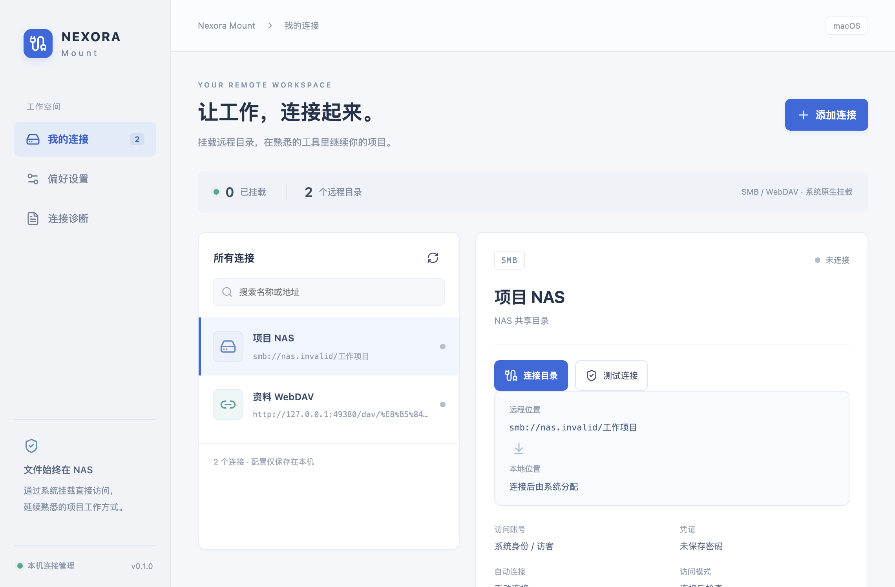

# Nexora Mount

**开源的 NAS 目录挂载管理工具，采用 MPL-2.0 许可证。**

[](LICENSE)
[](https://github.com/zhangzzj2003/Nexora-Mount/actions/workflows/check.yml)

用 Windows/macOS 系统原生挂载访问 NAS 工作目录。基于 Electron + Vue 3 + Node.js + TypeScript；Electron 管理连接，文件内容由系统 SMB/WebDAV 客户端直接传输。

**下载测试版：[GitHub Releases](https://github.com/zhangzzj2003/Nexora-Mount/releases)。** 首版为预览版本，安装包尚未正式签名、公证，真实 NAS 与双电脑工作流的验收状态见 [验证记录](docs/verification.md)。



## 当前版本

- SMB 与 WebDAV 连接的新增、编辑、删除、端口测试、挂载、正常卸载和目录打开。
- Windows 自动/指定盘符，macOS 使用 NetFS 返回的实际挂载位置。
- 系统加密保护密码、本地原子配置保存、托盘、登录启动、应用启动自动连接。
- 网络恢复检查、退避重试、超时后重新核对挂载、可预览和编辑的脱敏诊断。
- 文件内容与工作目录不进入应用的本地同步队列；并发编辑沿用编辑器与 AI 工具本身的协调方式。

首版目标：Windows 10/11 x64、macOS 13+ Intel/Apple Silicon。真实 NAS 与不同编辑器的行为需按 [验收说明](docs/acceptance.md) 验证。

## 本地开发

需要 Node.js 22.12+ 与 pnpm 10。

```sh
pnpm install
pnpm dev
```

```sh
# 类型检查、业务测试与桌面自动化。
pnpm format:check
pnpm typecheck
pnpm test
pnpm test:e2e

# 在 macOS 上额外验证本机临时 WebDAV 的真实挂载读写。
# 使用系统 Apache，只监听 127.0.0.1，测试结束正常卸载并清理临时文件。
NEXORA_NATIVE_E2E=1 pnpm test:e2e
```

## 使用

1. 在 NAS 开启 SMB 或 WebDAV，创建有相应共享权限的账号。
2. 点击“添加连接”。SMB 分别填写主机名/IP 与共享名；WebDAV 填写完整 HTTP/HTTPS 地址和子路径。
3. 保存并测试连接。端口测试不验证账号，也不会向 NAS 写入测试文件。
4. 点击“连接目录”，然后“打开文件夹”。在 AI/编辑器中选择这个系统挂载路径。
5. 两台电脑配置同一共享目录；先用临时项目检查保存、刷新及并发任务协调。

关闭窗口默认进入托盘；明确退出程序会保留系统挂载，但不再执行应用重连。挂载不是离线同步：断网时操作可能失败。应用不强制卸载占用中的卷。修改地址、账号或删除配置前，需要先正常卸载。

## WebDAV 系统限制

Windows 依赖 WebClient 服务。该组件已被微软标记为弃用，部分系统可能没有或禁用了它。应用检测服务及当前 `FileSizeLimitInBytes`；不会自动修改注册表、提升权限或重启服务。请根据系统策略配置，优先使用 SMB 访问项目目录。

macOS 原生 WebDAV 的写入要求服务端支持 DAV LOCK。缺少支持时可能以只读方式挂载。应用显示系统报告的只读状态，最终写权限还取决于 NAS 账号与目录 ACL。

HTTPS 使用系统信任。自签证书需要先由用户在 Windows 证书管理或 macOS 钥匙串中建立恰当信任，证书域名必须与连接地址一致。不要通过关闭校验解决证书错误。系统 API 对部分 TLS 错误只返回通用状态，必要时结合 NAS 和系统日志检查。

## 打包

```sh
pnpm dist:mac
pnpm dist:win
```

输出在 `dist/`。macOS 分别生成 arm64/x64 DMG，Windows 为 x64 NSIS 安装包。发布构建优先在对应系统执行；macOS 代码签名和公证需要 Apple Developer 证书，Windows 签名需要对应证书。未提供证书时生成测试包，不能将构建成功等同于签名、公证或 SmartScreen 认可。

## GitHub 自动检查与构建

每次分支推送或提交 PR，[GitHub Actions](https://github.com/zhangzzj2003/Nexora-Mount/actions/workflows/check.yml) 都会在 Windows/macOS 检查格式、类型、业务逻辑、Electron 桌面流程及目录包构建。同一分支的新提交会取消旧检查。

推送到 `main` 或在 Actions 点击 **Run workflow**，还会生成 Windows x64 安装包及 macOS arm64/x64 DMG。打开对应运行记录，在页面底部 **Artifacts** 下载 `installers-Windows-*` 或 `installers-macOS-*`（需登录 GitHub，保留 14 天）。失败时保存诊断文件 7 天。这些是未签名测试包，正式版本仍在 Releases 单独发布。

详见 [开发说明](docs/development.md)、[验收说明](docs/acceptance.md)、[本次验证记录](docs/verification.md)。飞牛 ID、中继和自动合并属于后续阶段。

## 许可证

自有代码采用 MPL-2.0，参见 [LICENSE](LICENSE)。发布时须保留第三方许可；系统框架由操作系统提供，应用不捆绑 WinFsp/macFUSE。
